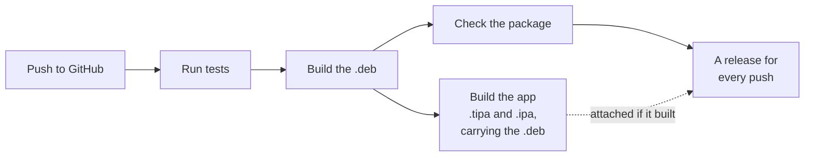

<p align="center">
  
</p>

<h1 align="center">Speaka</h1>

<p align="center">
  <b>Turn a jailbroken iPhone into a Bluetooth speaker for your PC.</b><br>
  Your PC lists the iPhone as a speaker. What it plays comes out of the iPhone's loudspeaker, wired earbuds, or any iOS output.
</p>

<p align="center">
  <a href="https://github.com/m9z2w4d8vw-blip/Speaka/actions/workflows/build.yml"></a>
  <a href="https://github.com/m9z2w4d8vw-blip/Speaka/releases/latest"></a>
  
  
  
</p>

<p align="center">
  <a href="#install"><b>Install</b></a> &nbsp;·&nbsp;
  <a href="#using-speaka"><b>Using Speaka</b></a> &nbsp;·&nbsp;
  <a href="#troubleshooting"><b>Troubleshooting</b></a> &nbsp;·&nbsp;
  <a href="#how-it-works"><b>How it works</b></a> &nbsp;·&nbsp;
  <a href="#building-and-testing"><b>Building</b></a>
</p>

---

iOS only implements the *sending* side of Bluetooth audio (A2DP Source): it can stream to headphones, but nothing can
stream to it. Speaka adds the *receiving* side (A2DP Sink), the role that speakers and headphones implement, to the
iPhone's Bluetooth daemon.

**Status:** working end to end with a Windows laptop. That covers connecting and streaming; pausing, resuming and
changing songs; switching outputs during playback; and wired earbuds without replugging.

**AVRCP volume research:** an optional, disabled-by-default volume layer and a build-specific native adapter are
documented in [AVRCP-VOLUME.md](docs/AVRCP-VOLUME.md), with reproducible disassembly evidence. Host tests cover the
protocol and PCM gain; Windows/iPhone interoperability and the native hooks still require live testing.

> [!WARNING]
> Speaka is experimental. It changes how a system daemon behaves through undocumented internals, and it supports
> **exactly one** `bluetoothd` build, from iOS 17.0 (see [Requirements](#requirements)). On any other build it hooks
> nothing, so you get no speaker rather than a broken Bluetooth.

## Install

1. Install **`Speaka.tipa`** from the [latest release](https://github.com/m9z2w4d8vw-blip/Speaka/releases/latest)
   with TrollStore.
2. Open Speaka and tap **Install Tweak**. It installs the tweak the app carries; nothing else to download.
3. Tap **Start**, then connect from the PC and choose the iPhone as its output. On Windows, pair it under
   *Bluetooth & devices* the first time.

**Start** restarts Bluetooth, and your other devices reconnect on their own. The speaker lasts until Bluetooth next
restarts (see [When to tap Start again](#when-to-tap-start-again)). To remove everything, hold **Uninstall** in the
app for 4 seconds.

## Requirements

| | |
| --- | --- |
| **iPhone** | iOS 17.0, arm64e. Developed on an iPhone 13. |
| **Jailbreak** | Rootless Dopamine with ElleKit and PreferenceLoader. TrollStore for the app. |
| **Sending device** | Any Bluetooth audio source that uses SBC. Developed with a Windows laptop. |

<details>
<summary><b>The exact <code>bluetoothd</code> build, and how Speaka checks it</b></summary>

<br>

| | |
| --- | --- |
| Size | 10,196,720 bytes, arm64e |
| SHA-256 | `e9408df54c3eebfd263eb745a0b06cf1130dd3228f56c104697f92264c91dbd6` |
| LC_UUID | `5491BA47-B5AE-3D44-9536-B30161DF1E90` |

The tweak hooks functions by address, and addresses only hold for one build. Before hooking, it checks the daemon's
LC_UUID and the first four instructions of every function it touches. On any mismatch it logs the reason and hooks
nothing. **Settings > Speaka > Status** (*Loaded in daemon: Yes - 5 hooks*) and the first block of the debug log show
whether it loaded. The package depends on `mobilesubstrate`, `preferenceloader` and `firmware (>= 14.0)`.

</details>

## Using Speaka

### The app

- **The big button** reads **Start**, or **Stop** while the speaker is on. Tapping it opens into a log with a line
  for each step Bluetooth goes through, ending with *Ready for your PC*. If a step fails, its line says so and the
  header keeps the tweak's own reason.
- **The connection line** above it says what's happening: *LAPTOP-XXXX · connected* while the PC is connected or
  paused, *LAPTOP-XXXX · iPhone speaker* while it plays, or *Connect from your PC*.
- **The header** reads *by Parv*, or, when something needs you, says what in the warning colour: for example that the
  volume is at zero, or that Bluetooth was turned off and on.
- **Settings** has **Kill Bluetooth** (`killall -9 bluetoothd`, from the app: Bluetooth restarts at once, without the
  speaker) and **Update notifications**.
- **Audio Output** chooses where the sound plays; see [Where the audio plays](#where-the-audio-plays).
- **Uninstall**, held for 4 seconds, removes the tweak, Speaka's logs, settings and downloads, and the app. A tap does
  nothing; while you hold, a gray fill sweeps across the row, and letting go early cancels. If the tweak can't be
  removed, nothing else is, and the header says why.
- **Credits** shows the app's and the tweak's versions, and the license of the interface, which Speaka shares with Caz.

### Updates

When a newer release is out, **Update Available** appears above the button. Tapping it shows the changelog, and
**Update** installs it: TrollStore installs the new app, then dpkg installs the tweak the new app carries, which
restarts Bluetooth, so a running speaker stops. With **Update notifications** on, the app checks every 2 minutes while
it's open, and asks iOS to check in the background as well (iOS decides how often, and never once Speaka has been
swiped away).

### When to tap Start again

The speaker lasts as long as that run of Bluetooth. Tap **Start** again after any of these:

- a reboot, which on Dopamine also means re-jailbreaking;
- a userspace reboot;
- turning Bluetooth or Airplane Mode off and on. Settings then reads *Off - Bluetooth was turned off and on; tap Start*.

**Stop** restarts Bluetooth without the speaker, back to normal.

### Where the audio plays

**Audio Output** in the app takes effect immediately, even mid-song:

| Mode | Plays on | Good to know |
| --- | --- | --- |
| **iPhone speaker** (default) | The built-in loudspeaker, always | Ignores plugged-in headphones. The most tested mode. |
| **Wired headphones or earbuds** | A wired or USB headset plugged into the iPhone | Never uses Bluetooth, so the sound can't go back to the PC. Waits while nothing is plugged in. |
| **Any device (follow iOS)** | Wherever iOS is playing | The mode for Bluetooth earbuds |

> [!TIP]
> For **Bluetooth earbuds**, choose *Any device* and pick the earbuds with **Choose Output Device** in the app's
> Audio Output, or in Control Center. Your PC is itself a Bluetooth audio device to iOS, and
> since it connects last, iOS may send the sound back to it. If the connection line shows your PC, pick the earbuds
> again.

### Settings > Speaka

**Status** shows whether the tweak loaded into `bluetoothd`, its last event and where it logs. **Debug log** shows the
full log, and copies it or saves it to iCloud Drive. Start, Stop and the audio output are in the app.

## Troubleshooting

| Symptom | Likely cause | What to do |
| --- | --- | --- |
| The PC connects and drops at once, or finds no speaker | No speaker since the last Bluetooth restart | Tap **Start**, then reconnect from the PC. |
| *Bluetooth was turned off and on* | Toggling Bluetooth rebuilt Apple's endpoints without the speaker | Tap **Start**. |
| Start ends with *Still waiting* | Bluetooth still runs a tweak without the Start handler | Tap **Install Tweak** or **Update**, or run `sudo killall -9 bluetoothd`. Then Start again. |
| The PC plays, the iPhone is silent, and the connection line shows your PC | *Any device* is sending the sound back to the PC | Choose *iPhone speaker* or *Wired headphones*, or pick your earbuds with **Choose Output Device**. |
| The app says the volume is at 0% | That output's volume is at zero | Raise the iPhone's volume while audio plays. |
| Wired mode is silent and the connection line says it's waiting | Nothing is plugged in | Plug the headset in; playback starts by itself. |
| The sound stopped after a call, Siri or another app | iOS interrupted playback | Pause and play on the PC. |
| **Update Available** never appears | The app checks once per launch; offline, or GitHub's limit of 60 checks an hour was reached | Open the app again later, or install from the [latest release](https://github.com/m9z2w4d8vw-blip/Speaka/releases/latest). |
| *Update failed* after *Installing the tweak* | dpkg reported an error, often because Sileo or Zebra was installing at the same time | Close the package manager and tap **Update** again. |
| Bluetooth misbehaves in general | | Tap **Stop**, or **Settings > Kill Bluetooth** in the app. |

When something goes wrong, open **Settings > Speaka > View debug log** right away and use **Save Log to iCloud Drive**.

## Logs

**View debug log** in Settings > Speaka gathers the tweak's status, its log, and an **AUDIO HELPER** section with the
output mode, the helper's last status and its own log. **Copy log to clipboard** and **Save Log to iCloud Drive**
export the same text.

<details>
<summary><b>Log files, copying them to a PC, and the lines worth knowing</b></summary>

<br>

| File | Written by | Notes |
| --- | --- | --- |
| `/tmp/FTABHarvest/Speaka.log` | The tweak inside `bluetoothd` | Cleared past 512 KB; the last 480 lines are mirrored into preferences for Settings. Traffic is summarized every 2 s. |
| `/tmp/FTABHarvest/BTPSAudioHelper-v88.log` | The audio helper | Timestamped like the daemon log. It grows indefinitely; Settings reads only its tail. |

```powershell
scp mobile@<iphone-ip>:/tmp/FTABHarvest/Speaka.log "$env:USERPROFILE\Downloads\"
scp mobile@<iphone-ip>:/tmp/FTABHarvest/BTPSAudioHelper-v88.log "$env:USERPROFILE\Downloads\"
```

| Line | Meaning |
| --- | --- |
| `diag.v89.build: v9.4.0-one-tap-output-select` | The tweak build running inside `bluetoothd` |
| `diag.v89.session: start nonce=... result=ARMED` | Start restarted Bluetooth and armed the speaker |
| `diag.v95.peer: paused` | The PC's side of the stream: *configured* (set up), *streaming*, *paused*, or *closed* |
| `diag.v82.sep: LOCAL register=0 SEID=7 role=SNK ...` | The speaker endpoint is registered |
| `V88_CONFIG handle=1 local_seid=7 remote_seid=...` | The PC configured a stream |
| `V88_STREAM active=1 generation=N` | The stream started (`active=0`: paused or closed) |
| `V893_RX 2000ms forwarded=... ok=... decoded=... bad=...` | Two seconds of reception; errors are also logged individually |
| `V881_PCM ... peak=... \| RENDER ... silence_frames=...` | Audio level, and underruns (`silence_frames`) |
| `V882_HEALTH ready=0 ... why=0x20` | Helper health. `0x1` stream inactive, `0x2` no queue, `0x4` queue stopped, `0x8` stopping, `0x10` enqueue error, `0x20` wrong output for the mode |
| `V882_IDLE_GUARD action=keep` | The guard kept the stream alive instead of iOS's idle suspend |
| `V82 TX_SIGNAL ... msg=0 sig=9` / `V82 RX_SIGNAL ... msg=0 sig=9` | The phone / the PC paused the stream (`sig=7` start, `sig=8` close) |
| `V882_CONTROL ... by=phone` / `by=pc` | Who started or suspended the stream. `by=phone` is Apple's own code treating the PC as an output |
| Helper `V889_AUDIO_ROUTE stage=... mode=... type=... name=...` | Exactly where the audio went |
| Helper `V882_AUDIO_STOP reason=...` | Why the helper stopped playing |
| Helper `V882_INTERRUPTION type=began reason=...` | iOS interrupted playback |
| Helper `V91_SESSION active=... why=...` | The helper's audio session changed. Expect one per playback, not one per second |
| Helper `V91_STREAM_CHANGE ... output=kept` / `V91_START_DEFERRED reason=...` | A stream change that kept playing / why playback is waiting |

Offline helpers in `tools/`:

| Script | Purpose |
| --- | --- |
| `fetch_google_sbc.sh` | Fetches Google libsbc at the pinned commit (CI runs it) |
| `inspect_bluetoothd.py` | Read-only evidence collector for a `bluetoothd` binary |
| `windows_bluetooth_snapshot.ps1` | Read-only snapshot of the PC's Bluetooth state |

</details>

## How it works

1. **Start:** the app writes a request to Bluetooth's preferences and posts a notification. The tweak, inside
   `bluetoothd`, arms a one-shot session and restarts `bluetoothd`.
2. **The check:** on relaunch the tweak confirms this is the one `bluetoothd` build it was written for (its UUID and
   the first instructions at every hook address) and hooks nothing otherwise.
3. **Becoming a speaker:** it gives the AVDTP endpoint table a seventh slot, registers an A2DP Sink (SEID 7) after
   iOS's six Sources, and publishes the Audio Sink SDP record (`0x110B`) that tells the PC it's a speaker.
4. **The audio:** hooks on AVDTP signalling follow the PC's stream, and the media hook copies its SBC packets into a
   shared-memory ring in `/tmp/FTABHarvest`.
5. **Playback:** the tweak connects to `127.0.0.1:37594`, so launchd starts the audio helper, which decodes the SBC
   with Google's libsbc and plays it on the chosen output.
6. **The rest:** the app polls the status for its screens, and its root helper installs updates and uninstalls through
   TrollStore and dpkg.

Each session ends at the next Bluetooth restart, which always comes back as normal Bluetooth. How each offset was
found is in [docs/BLUETOOTHD.md](docs/BLUETOOTHD.md).

## Repository layout

```text
.
├── tweak/                     the tweak loaded into bluetoothd (built by ./Makefile)
│   ├── Hooks.xm                   the build check and every hook
│   ├── BluetoothdBuild.h          offsets and signatures of the supported bluetoothd build
│   ├── SinkEndpoint.c             the speaker endpoint: capabilities, table checks, the seventh slot, its SDP record
│   ├── StreamControl.c            following the PC's stream from its AVDTP signalling
│   ├── AudioRelay.c               handing the audio to the helper, and waking it
│   ├── Session.c                  Start and Stop
│   ├── Log.c                      the debug log and status
│   └── Tweak.h                    what those files share
├── shared/                    used by the tweak and the helper (and SpeakaShared.h by Settings and the app)
│   ├── SpeakaShared.h             preference keys, notification names, log paths
│   ├── AudioRing.c/.h             the shared-memory ring that carries the audio
│   └── AACConfig.c/.h, LATM.c/.h  experimental AAC: the A2DP AAC configuration, and LATM depacketizing
├── Makefile, control, Speaka.plist
├── audiohelper/               the audio helper, installed as BTPSAudioHelper (built by audiohelper/Makefile)
│   ├── AudioHelper.m              playback: reading the ring, the audio session, choosing the output
│   ├── SBCDecoder.c/.h            decoding the PC's SBC with Google's libsbc (vendor_sbc/, fetched at build time)
│   ├── AACDecoder.c/.h, CodecDecoder.c/.h   experimental AAC decoding (AudioToolbox), and choosing the decoder
│   ├── AACSelfTest.c/.h           BTPSAudioHelper --aac-selftest, the on-device AAC check (tools/device_test)
│   └── OutputPolicy.h             where to play and when to let go, in plain C the tests run
├── settings/                  the Speaka page in Settings, installed as SpeakaPrefs.bundle
│   ├── SettingsPage.m             the status rows and the debug log's buttons
│   └── DebugLog.h/.m              reading the log back, and the screen that shows it
├── app/                       the Speaka app (SwiftUI, Caz's design), packaged as Speaka.tipa / Speaka.ipa
├── layout/                    install scripts, the helper's launchd job, the Settings entry
├── tests/                     one file per part: test_tweak, test_audio, test_start_stop, test_settings_page,
│                              test_app, test_aac, test_build (many compile the real C sources);
│                              fakes/ stands in for AudioToolbox where Apple's SDK isn't available
├── tools/                     offline scripts; device_test/, the kit for checks run on the phone over SSH
├── docs/                      CHANGELOG.md (every release), BLUETOOTHD.md (how each part of bluetoothd was found)
└── .github/workflows/         CI: test, build, package, publish
```

Shared sources exist once, in `shared/`. A subproject that needs one holds a one-line `#include "../shared/file.c"`,
so the copies can't drift apart. `tests/test_build.py` fails CI with an explanation in any of these cases:

- a file lands in the wrong folder;
- a `(1)` duplicate appears;
- a source in `tweak/` or `shared/` becomes unused;
- `docs/CHANGELOG.md` has no entry for the version being built;
- a README link or `#` anchor breaks.

## Building and testing



Every push runs `.github/workflows/build.yml` on macOS with Xcode and Theos: it fetches the pinned libsbc, runs every
test, builds and checks the `.deb`, then builds the app with the `.deb` inside it. Each push to `main` publishes a
release named after its version (`control`'s `Version` plus the run number, so `9.8.74`) with the `.deb`,
`Speaka.tipa`, `Speaka.ipa` and `SHA256SUMS`; its notes are the push's commit messages, which the app shows as the
changelog. If the app fails to build, the release still goes out with the `.deb`. Uploads and publishing are retried,
since GitHub's services sometimes fail partway.

<details>
<summary><b>Building locally, the tests, the app, and porting</b></summary>

<br>

You need macOS with Xcode and [Theos](https://theos.dev) for the tweak, and XcodeGen and ldid for the app
(`brew install xcodegen ldid`):

```sh
export THEOS=~/theos
bash tools/fetch_google_sbc.sh       # Google libsbc at the pinned commit
make clean package FINALPACKAGE=1    # packages/com.parv.speaka_*.deb (rootless, arm64 + arm64e)
DEB="$PWD/packages/com.parv.speaka_9.8_iphoneos-arm64.deb" make -C app tipa   # app/packages/Speaka.tipa and .ipa
```

The build is rootless only. `BTPS_WITH_PREFS=0` skips the Settings bundle.

```sh
python3 -m unittest discover -s tests -v
BTPS_SANITIZE=1 python3 -m unittest discover -s tests    # AddressSanitizer + UBSan where tests compile C
```

The tests check the sources, and compile the real C (the ring, stream control, the relay, the decoder, the output
policy, the root helper) with the host compiler. There's no Apple compiler on a Linux host, so `tests/test_app.py`
also checks the Swift: balanced code, every type and member used being defined, and every Objective-C method called by
its pinned Swift name. The decoder test needs libsbc, so run `tools/fetch_google_sbc.sh` first; without it,
`AudioRuntime` in `tests/test_audio.py` fails by design.

**The app** is built the way Caz is: XcodeGen generates the project from `app/project.yml`, `xcodebuild` compiles it,
clang builds the root helper from `app/RootHelper/main.c`, and `app/scripts/package.sh` signs both with `ldid` and
zips them. It reads the tweak's status from `com.apple.bluetooth`'s preferences, which takes the
`platform-application` and `com.apple.private.security.no-sandbox` entitlements; `com.apple.private.persona-mgmt`
lets it start the root helper, which installs updates (`install-update`), kills Bluetooth (`kill-bluetooth`) and
uninstalls (`remove-tweak`, `uninstall-app`).

**Porting** to another iOS build means finding every offset and signature in `tweak/BluetoothdBuild.h` and
`tweak/Hooks.xm` again. [docs/BLUETOOTHD.md](docs/BLUETOOTHD.md) records how each was found, and
`tools/inspect_bluetoothd.py` collects the evidence.

</details>

## Safety and recovery

> [!CAUTION]
> If Bluetooth misbehaves, recover in this order, from least to most drastic:
>
> 1. **Stop** in the app.
> 2. **Settings > Kill Bluetooth** in the app, or `sudo killall -9 bluetoothd`.
> 3. Hold **Uninstall** in the app for 4 seconds. Without the app: `sudo dpkg -r com.parv.speaka`, then
>    `sudo killall -9 bluetoothd`.

The tweak refuses to hook a build it wasn't made for, leaves Apple's own signalling and Source endpoints alone, and
arms each speaker session only once, so the next Bluetooth restart always comes back as normal Bluetooth.

## Known limitations

- **One `bluetoothd` build**, from iOS 17.0.
- **One session per Bluetooth run.** Tap Start again after a restart or a Bluetooth toggle.
- **SBC only, one stream at a time.** The Windows laptop it was developed with sends SBC at its best standard
  setting (about 328 kbps); AAC isn't supported yet.
- **Playback is controlled from the PC.** There are no media controls on the iPhone.
- **Bluetooth earbuds are less tested.** iOS may switch the sound back to the PC when it reconnects, and receiving
  and sending audio at the same time hasn't been tested on a device.
- **iOS lists the PC as an output.** That comes from bluetoothd and is not fixed. If the phone suspends the stream
  as playback starts, the sound begins once Windows reopens the stream, about 6 s later.

## Changelog

Every release, newest first, is in [docs/CHANGELOG.md](docs/CHANGELOG.md).

## Credits

- [**Google libsbc**](https://github.com/google/libsbc) (Apache-2.0) decodes the audio. It's fetched at build time at
  commit `6e505650145c9973d08a0bdd5e5f5e1914305e40` and isn't committed.
- The app's interface, updater included, is [**Caz**](https://github.com/m9z2w4d8vw-blip/Caz)'s, on Speaka's own
  background. Caz's is adapted from [**Dopamine**](https://github.com/opa334/Dopamine) by Lars Fröder (opa334) and its
  contributors under the MIT License, which ships in the app under **Credits**.
- The app's title is a picture of "Speaka" drawn in [Fonarto](https://www.fontspace.com/fonarto-2-font-f104632)
  Regular, the same way as Caz's (`app/scripts/make_wordmark.py`). Fonarto is by Locomotype and free for personal and
  commercial use; only the picture ships, not the font.
- The tweak is built with [**Theos**](https://theos.dev) and the app with [**XcodeGen**](https://github.com/yonaskolb/XcodeGen).
  It runs on Dopamine with ElleKit and PreferenceLoader.
