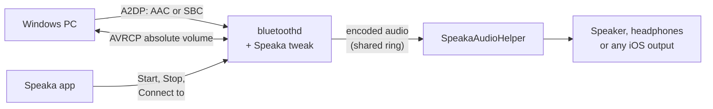
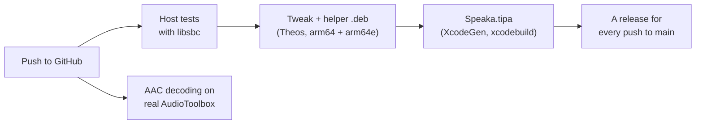

<p align="center">
  
</p>

<h1 align="center">Speaka</h1>

<p align="center">
  <b>Turn your iPhone into a Bluetooth speaker for your PC.</b><br>
  Windows streams to it over A2DP, in AAC or SBC, and it plays through the iPhone's speaker or headphones.
</p>

<p align="center">
  <a href="https://github.com/m9z2w4d8vw-blip/Speaka/actions/workflows/build.yml"></a>
  <a href="https://github.com/m9z2w4d8vw-blip/Speaka/releases/latest"></a>
  
  
  
  
</p>

<p align="center">
  <a href="#install"><b>Install</b></a> &nbsp;·&nbsp;
  <a href="#using-speaka"><b>Using Speaka</b></a> &nbsp;·&nbsp;
  <a href="#troubleshooting"><b>Troubleshooting</b></a> &nbsp;·&nbsp;
  <a href="#how-it-works"><b>How it works</b></a> &nbsp;·&nbsp;
  <a href="#building-and-testing"><b>Building</b></a>
</p>

---

An iPhone can send audio to a Bluetooth speaker, but it can't be one: iOS only plays the A2DP *Source* role. Speaka
adds the other side to iOS's own Bluetooth daemon, an A2DP *Sink* that a Windows PC streams to like any speaker. The
iPhone plays what arrives through its speaker, wired headphones or any output iOS offers, and the volume follows
either device. A companion app starts and stops the speaker, connects to your computer, and keeps Speaka up to date.

> [!NOTE]
> Speaka has been tested on one setup: an iPhone 13 on iOS 17.0 with Dopamine, streaming from Windows 11. It hooks one
> exact `bluetoothd` build and refuses to load on any other, so it can't harm Bluetooth on a phone it wasn't made for.

## Features

| | |
| --- | --- |
| **A2DP Sink** | Windows sees the iPhone as a speaker. Speaka offers AAC-LC first and SBC as the fallback; the PC chooses. |
| **Where it plays** | The iPhone's speaker, wired headphones, or any output iOS offers, including Bluetooth earbuds. |
| **Connect from either side** | From Windows as with any speaker, or from the iPhone with **Connect to**. |
| **Connect to** | The computers that streamed to Speaka, the paired ones and those nearby, with which is connected. |
| **Two-way volume** | Windows' slider sets the iPhone's volume, and the iPhone's buttons move Windows' slider (AVRCP absolute volume). |
| **The connected computer** | Its name and status show above the big button. |
| **Updates** | A notification for each release, and one tap to install the tweak and the app together. |
| **Clean removal** | One button removes the tweak, its files and the app. |

## Install

1. Install **`Speaka.tipa`** from the [latest release](https://github.com/m9z2w4d8vw-blip/Speaka/releases/latest)
   with TrollStore.
2. Open Speaka and tap **Install Tweak**. The app carries the tweak and installs it; there's nothing else to download.
3. Tap **Start**, then connect from the PC: see [Using Speaka](#using-speaka).

The tweak can also be installed on its own: the release's `Speaka_<version>_iphoneos-arm64.deb`, with Sileo or
`dpkg -i`. The app is still how you start, stop and connect. To remove everything, tap **Uninstall** in the app and
confirm.

## Requirements

| | Tested | Also built for |
| --- | --- | --- |
| **iPhone** | iPhone 13 (arm64e), iOS 17.0 | — |
| **Jailbreak** | Dopamine, rootless, with ElleKit and PreferenceLoader; TrollStore for the app | — |
| **Computer** | Windows 11 | Any A2DP source using AAC or SBC (untested) |
| **Builds** | — | The app targets iOS 16.0 and later; the tweak and helper, iOS 15.0 and later, arm64 and arm64e |

<details>
<summary><b>The exact <code>bluetoothd</code> build, and how Speaka checks it</b></summary>

<br>

| | |
| --- | --- |
| Size | 10,196,720 bytes, arm64e |
| SHA-256 | `e9408df54c3eebfd263eb745a0b06cf1130dd3228f56c104697f92264c91dbd6` |
| LC_UUID | `5491BA47-B5AE-3D44-9536-B30161DF1E90` |

The tweak hooks functions by address, and addresses only hold for one build. Before hooking, it checks the daemon's
LC_UUID and the first instructions of every function it touches; on any mismatch it logs the reason and hooks nothing.
**Settings > Speaka > Status** shows whether it loaded. The package depends on `mobilesubstrate`, `preferenceloader`
and `firmware (>= 14.0)`.

</details>

## Using Speaka

### First time

1. **Open Speaka and tap Start.** Start restarts Bluetooth with the speaker; your other devices reconnect by
   themselves. The log under the button ends with *Ready for your PC*.
2. **Pair from Windows:** *Settings > Bluetooth & devices > Add device > Bluetooth*, then the iPhone.
3. **Choose the iPhone as the output** if Windows didn't switch to it, and play something.

After that, connect from either side: from Windows as with any speaker, or from the iPhone with **Connect to**.

### The app

- **The big button** reads **Start**, or **Stop** while the speaker is on. Tapping it opens into a log with a line for
  each step, and if one fails, its line says why.
- **The connection line** above it names the computer and what it's doing: *LAPTOP-XXXX · connected* while it's
  connected or paused, *LAPTOP-XXXX · iPhone speaker* while it plays.
- **Connect to** lists *Recently connected*, *Nearby devices* and *Other paired devices*. **Connect** links a paired
  computer; Windows then sets up the audio itself. A row reads *Connected* only while that computer streams to Speaka.
- **Audio Output** chooses where the sound plays; see [Where the audio plays](#where-the-audio-plays).
- **Settings** has **Kill Bluetooth**, which restarts Bluetooth at once without the speaker (the same as
  `killall -9 bluetoothd`), **Update notifications**, **Check for Updates** and **Credits**.
- **Uninstall** asks first, showing what it removes: the tweak, Speaka's files and logs, then the app. Tap
  **Uninstall** to go ahead, or **Cancel**.

**Settings > Speaka**, in iOS's Settings, shows the tweak's status and has **View debug log**.

### Volume

Change the volume on either device; the other follows. Windows' slider sets the iPhone's own volume, so Control
Center, the buttons and Windows always agree, and Speaka never turns the audio down a second time.

### Where the audio plays

**Audio Output** in the app takes effect immediately, even mid-song:

| Mode | Plays on | Good to know |
| --- | --- | --- |
| **iPhone speaker** (default) | The built-in loudspeaker, always | Ignores plugged-in headphones. The most tested mode. |
| **Wired headphones or earbuds** | A wired or USB headset plugged into the iPhone | Waits while nothing is plugged in, and starts when something is. |
| **Any device (follow iOS)** | Wherever iOS is playing | The mode for Bluetooth earbuds |

> [!TIP]
> For **Bluetooth earbuds**, choose *Any device*, then pick the earbuds with **Choose Output Device** in Audio Output,
> or in Control Center. Your PC is a Bluetooth audio device to iOS too, so if the connection line shows your PC, pick
> the earbuds again.

### When to tap Start again

The speaker lasts as long as that run of Bluetooth. Tap **Start** again after any of these:

- a reboot, which on Dopamine also means re-jailbreaking;
- a userspace reboot;
- turning Bluetooth or Airplane Mode off and on. Settings then reads *Off - Bluetooth was turned off and on; tap
  Start*.

**Stop** restarts Bluetooth without the speaker, back to normal.

## Updates

When a newer release is out, **Update Available** appears above the big button. Tapping it shows what changed, and
**Update** installs the release's tweak and app, then resprings. **Check for Updates** in Settings checks at once and
says why a check failed.

With **Update notifications** on, Speaka's update checker looks for a new release every 15 minutes, even when the app
is closed, and posts one notification per release. Tapping it opens the update.

## Troubleshooting

| Symptom | Likely cause | What to do |
| --- | --- | --- |
| The PC connects and drops at once, or finds no speaker | No speaker since the last Bluetooth restart | Tap **Start**, then reconnect from the PC. |
| *Bluetooth was turned off and on* | Toggling Bluetooth rebuilt Apple's endpoints without the speaker | Tap **Start**. |
| Start ends with *Still waiting* | Bluetooth still runs a tweak without the Start handler | Tap **Install Tweak** or **Update**, or run `sudo killall -9 bluetoothd`. Then Start again. |
| **Connect to** shows *Connected to this iPhone · choose Speaka as its output* | The Bluetooth link is up, but Windows didn't set up the audio | Choose Speaka as the output on the computer. |
| The computer isn't under **Nearby devices** | It isn't discoverable | Open *Bluetooth & devices* on the computer, then tap **Rescan**. |
| The PC plays, the iPhone is silent, and the connection line shows your PC | *Any device* is sending the sound back to the PC | Choose *iPhone speaker* or *Wired headphones*, or pick your earbuds with **Choose Output Device**. |
| The app says the volume is at 0% | That output's volume is at zero | Raise the iPhone's volume while audio plays. |
| Wired mode is silent and the connection line says it's waiting | Nothing is plugged in | Plug the headset in; playback starts by itself. |
| The sound paused for a call, Siri or another app | iOS interrupted playback | It resumes when the interruption ends. If it doesn't, pause and play on the PC. |
| **Update Available** never appears | The check failed: offline, or GitHub's hourly limit was reached | **Check for Updates** in Settings says why, or install from the [latest release](https://github.com/m9z2w4d8vw-blip/Speaka/releases/latest). |
| *Update failed* after *Installing the tweak* | dpkg reported an error, often because Sileo or Zebra was installing at the same time | Close the package manager and tap **Update** again. |
| Bluetooth misbehaves in general | | Tap **Stop**, or **Settings > Kill Bluetooth** in the app. |

When something goes wrong, open **Settings > Speaka > View debug log** right away and use **Save Log to iCloud
Drive**.

## Logs

Everything logs to `/tmp/FTABHarvest/` on the phone:

| File | Written by |
| --- | --- |
| `Speaka.log` | The tweak, in `bluetoothd`: the connection, the stream, volume and the audio's arrival |
| `SpeakaAudioHelper.log` | The audio helper: the output, the codec and playback |
| `SpeakaConnect.log` | The app's **Connect to** page: scans and each connection attempt |
| `SpeakaUpdateCheck.log` | The update checker |

```powershell
scp mobile@<iphone-ip>:/tmp/FTABHarvest/Speaka.log "$env:USERPROFILE\Downloads\"
```

<details>
<summary><b>The lines worth knowing</b></summary>

<br>

| Line | Meaning |
| --- | --- |
| `V105_PEER address=... name=...` | A computer configured Speaka's stream; it's recorded in Connect to's history |
| `V113_AVDTP from=pc START command` | Each AVDTP signal, named, with who sent it |
| `V88_STREAM active=1` | The stream started (`active=0`: paused or closed) |
| `V893_RX ... forwarded=N` | Audio packets arriving from the PC |
| `V881_PCM ... nonzero=N` | Decoded audio going to the output |
| `AVRCP_VOLUME set value=V from=windows` | Windows set the volume |
| `AVRCP_VOLUME local value=V from=iphone ... outcome=changed_sent` | The iPhone's volume, sent to Windows |
| `LINK ... up`, `AUDIO ... set up` (SpeakaConnect.log) | A connection from the iPhone: the Bluetooth link, then Speaka's audio |

</details>

## How it works



1. **Start:** the app restarts `bluetoothd` with the speaker armed for one session. The tweak registers two Sink
   endpoints, AAC-LC first and SBC second, and advertises them, alongside Apple's own Source endpoints.
2. **The stream:** when the PC configures a stream, the tweak identifies the computer by its address, records it for
   Connect to, and follows the stream's AVDTP signaling.
3. **Playback:** the encoded audio goes into a shared-memory ring. launchd starts `SpeakaAudioHelper`
   (`com.parv.speaka.audio`), which decodes AAC or SBC and plays it through the chosen output, holding the audio
   session for as long as the speaker is on.
4. **Volume:** Windows' SetAbsoluteVolume sets iOS's output volume. The iPhone's own changes go back as AVRCP
   volume-changed notifications, which Windows registers for once per connection.
5. **Connect to:** the app reads iOS's Bluetooth devices through BluetoothManager. It connects with every service
   except A2DP, so the computer sets up the audio, as when it connects first.
6. **Updates:** the app downloads the release's `.deb` and `.tipa`, and its root helper installs both. The update
   checker, `SpeakaUpdateCheck`, runs in the background and posts the notification as Speaka.

| Part | Where | What it does |
| --- | --- | --- |
| Tweak | `tweak/` | The Sink endpoints, AVDTP and AVRCP handling, the computer's identity, Start and Stop |
| Audio helper | `audiohelper/` | Decoding, output, and the audio session |
| Shared code | `shared/` | The audio ring, the AAC transport, the volume engine, the device roster and the shared keys |
| App | `app/` | The SwiftUI app, and the root helper that installs updates |
| Settings page | `settings/` | Settings > Speaka |
| Update checker | `updatecheck/` | Background release checks and notifications |

The details live in [docs/](docs/):

- [BLUETOOTHD.md](docs/BLUETOOTHD.md): what the tweak hooks, and how each part was found.
- [CONNECT-TO.md](docs/CONNECT-TO.md): discovery, history, and connecting from the iPhone.
- [AVRCP-VOLUME.md](docs/AVRCP-VOLUME.md): two-way volume.
- [AAC-TESTING.md](docs/AAC-TESTING.md): AAC on the device.

## Repository layout

```text
.
├── tweak/                     the tweak, loaded into bluetoothd
│   ├── Hooks.xm                   installs the hooks, after checking the daemon's build
│   ├── SinkEndpoint.c             the AAC and SBC Sink endpoints and their SDP record
│   ├── StreamControl.c            the stream's AVDTP state
│   ├── AudioRelay.c               hands the audio to the helper
│   ├── Session.c                  Start and Stop
│   ├── PeerIdentity.c             which computer is connected, and its history
│   └── VolumeControl.m            AVRCP absolute volume
├── audiohelper/               SpeakaAudioHelper
│   ├── AudioHelper.m              the output and the audio session
│   ├── CodecDecoder.c             AAC or SBC, as configured
│   ├── AACDecoder.c, SBCDecoder.c     the two decoders
│   └── OutputPolicy.h             when to start, pause and take the output back
├── shared/                    used by more than one part
│   ├── AudioRing.c                the ring between the tweak and the helper
│   ├── VolumeControl.c            the AVRCP volume engine
│   ├── DeviceRoster.h             Connect to's devices and connection attempts
│   └── SpeakaShared.h             the keys and paths every part agrees on
├── app/                       the SwiftUI app
│   ├── Speaka/                    its screens and models
│   ├── RootHelper/                installs updates and removes Speaka, as root
│   └── project.yml                the XcodeGen project
├── settings/                  the Settings > Speaka page and its debug log
├── updatecheck/               SpeakaUpdateCheck, the background update checker
├── layout/                    the launchd jobs and the package's install scripts
├── tests/                     host tests: Python, and C harnesses compiled on the host
├── tools/                     fetching libsbc, release numbering, device tests, analysis
├── docs/                      the technical documents, the changelog, and Apple's reference binaries
└── .github/workflows/         CI: test, build, package, publish
```

## Building and testing



Every push runs `.github/workflows/build.yml`. It fetches Google's libsbc, runs the host tests, builds the rootless
`.deb` with Theos, then the app with XcodeGen and `xcodebuild`, and decodes AAC through Apple's real AudioToolbox on
macOS. Each push to `main` that passes publishes a release: `Speaka.tipa` for TrollStore, `Speaka.ipa`,
`Speaka_<version>_iphoneos-arm64.deb` and `SHA256SUMS`. The version is `control`'s plus the run number, so `9.9.108`,
and the notes are the push's commit messages, which the app shows as the changelog.

<details>
<summary><b>Building locally, and what the tests cover</b></summary>

<br>

```sh
tools/fetch_google_sbc.sh                                 # Google libsbc, into audiohelper/vendor_sbc/
make package FINALPACKAGE=1                               # the tweak and helper .deb (Theos, rootless)
make -C app                                               # Speaka.tipa (XcodeGen + xcodebuild, on macOS)
python3 -m unittest discover -s tests                     # the host tests
SPEAKA_SANITIZE=1 python3 -m unittest discover -s tests   # again, under AddressSanitizer and UBSan
```

`make package SPEAKA_WITH_SETTINGS=0` builds without the Settings page. Without libsbc, the one test that decodes
real SBC fails; CI fetches it.

- **The audio path:** the ring, both decoders against recorded streams, the AAC transport, and the output policy, in
  C compiled on the host.
- **Bluetooth:** the endpoint layout, the hooks' build checks against the reference `bluetoothd`, the AVRCP volume
  engine replaying real sessions, and Connect to's roster and connection attempts.
- **The app and packaging:** the Swift and Objective-C bridge, the root helper (compiled in a test mode), the
  launchd jobs, the install scripts and the release workflow. The Swift itself compiles only in CI.

</details>

## Safety and recovery

> [!CAUTION]
> If Bluetooth misbehaves, recover in this order, from least to most drastic:
>
> 1. **Stop** in the app.
> 2. **Settings > Kill Bluetooth** in the app, or `sudo killall -9 bluetoothd`.
> 3. **Uninstall** in the app, then confirm. Without the app: `sudo dpkg -r com.parv.speaka`, then
>    `sudo killall -9 bluetoothd`.

The tweak refuses to hook a build it wasn't made for, leaves Apple's own signaling and Source endpoints alone, and
arms each speaker session only once, so the next Bluetooth restart always comes back as normal Bluetooth.

## Known limitations

- **One tested setup.** iPhone 13 on iOS 17.0 with Dopamine, and Windows 11. Other `bluetoothd` builds are refused.
- **New computers are paired from the computer.** Connect to connects computers that are already paired.
- **Windows chooses its output.** After connecting from the iPhone, Windows sets up the audio itself; if it doesn't,
  choose Speaka as its output.
- **Playback is controlled from the computer.** The iPhone has no media controls.
- **The speaker lasts until Bluetooth restarts.** Tap Start again after a reboot or toggling Bluetooth.

## Changelog

Every release, newest first, is in [docs/CHANGELOG.md](docs/CHANGELOG.md).

## Credits

- [**Google libsbc**](https://github.com/google/libsbc) (Apache-2.0) decodes SBC. It's fetched at build time at commit
  `6e505650145c9973d08a0bdd5e5f5e1914305e40`, isn't committed, and its license is installed with the package.
- The app's interface, updater included, is adapted from [**Dopamine**](https://github.com/opa334/Dopamine) by Lars
  Fröder (opa334) and its contributors under the MIT License. The license ships in the app under **Settings >
  Credits** and in [`app/Resources/LICENSE-Dopamine.txt`](app/Resources/LICENSE-Dopamine.txt).
- The app's title is a picture of "Speaka" drawn in [Fonarto](https://www.fontspace.com/fonarto-2-font-f104632)
  Regular (`app/scripts/make_wordmark.py`). Fonarto is by Locomotype and free for personal and commercial use; only
  the picture ships, not the font.
- Built with [**Theos**](https://theos.dev) and [**XcodeGen**](https://github.com/yonaskolb/XcodeGen); runs on
  [**Dopamine**](https://github.com/opa334/Dopamine) with ElleKit and PreferenceLoader, and the app installs through
  [**TrollStore**](https://github.com/opa334/TrollStore).
